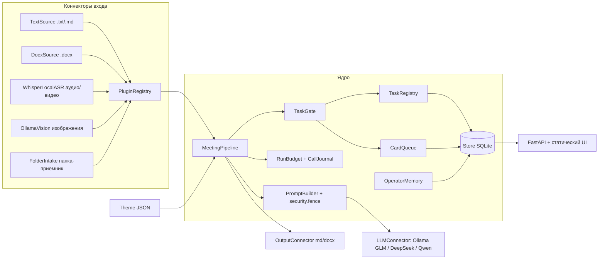

# ARCHITECTURE — MeetFlow

MeetFlow — абстрактная база для проектов, которые ведутся по совещаниям. Ядро превращает материалы встречи в протокол и реестр задач, а всё, что код не решил сам, отдаёт человеку карточкой. Тематика живёт в JSON-теме, внешние системы подключаются коннекторами.

## 1. Слои



## 2. Конвейер встречи

```mermaid
sequenceDiagram
  participant U as Оператор / папка
  participant P as Pipeline
  participant G as Модель-генератор
  participant C as Код (проверки)
  participant V as Модель-проверяющий
  U->>P: ingest(файл)
  P->>C: вид источника по содержанию, дубль по отпечатку, детектор инъекций
  P->>G: extract_tasks (кусками, строки пронумерованы)
  G-->>P: {tasks:[{description, assignee, line}]}
  P->>C: TaskGate: сомнение в поручении (цитата, вопрос/отрицание, отчёт, дубль) — карточка; сомнение в исполнителе — задача сразу + карточка выбора
  P->>G: closing_check (60 задач, ближе всего к сказанному; до 4 фраз на задачу)
  G-->>P: {closed:[{task_ref, phrase}]}
  P->>C: правило отрицаний, снятие только явными словами, «одна фраза — одна задача», массовое — карточкой
  P->>G: protocol (только разделы, без таблиц)
  P->>C: применить всё одним заходом, таблицы и шапку рисует код
  P->>V: verify (после сохранения)
  V-->>P: замечания
  P->>C: кодовые проверки черновика (оценочное слово, факт из чужого эпизода)
  P->>U: существенная находка — карточка оператору; протокол уже сохранён
```

Паттерны курса (занятие 6): **SEQUENTIAL с валидаторами** — основной путь; **ROUTER** — по виду источника (`PluginRegistry.resolve_source`: текст, ASR, Vision); **SUPERVISOR** и **AGENTIC RAG** сознательно не используются, как и в исходных проектах: модель не выбирает инструменты, оркестрирует код (позиция 4.2 — см. вопросы оператору).

## 3. Ключевые решения и откуда они

| Решение | Почему | Источник |
|---|---|---|
| Модель называет номер строки, цитату берёт код | выдуманные цитаты верификатора, «Задача №117» | ERP 19.09 |
| Узкие вызовы вместо одного | закрытия в общем запросе: 3 верных из 235 | Планёрка 22.09 |
| Таблицы рисует код | модель ни разу из 14 не вернула таблицу целой | Планёрка 22.09 |
| Протокол сохраняется сразу, проверка после | «ничего не ждут» | владелец 24.09 |
| Всё применяется в конце прогона | остановка по пределу не оставляет полупримененного реестра | урок cost-attack |
| Ответ оператора — правило после 2 одинаковых | защита от ошибочного нажатия | ERP 02.10 |
| Замок на данных | 7 из 10 одновременных правок терялись | ERP 02.10 |
| ASR только локально; модель — OpenRouter или Ollama, выбор при развёртывании | голос не покидает периметр; текст через OpenRouter с запретом хранения | владелец 24.09 и 03.10 |
| Потолок ответа 4096; обрыв — делим кусок, а не теряем встречу | денежный предел и зависания; 08.09 ERP падала целиком | владелец 03.10, прогон ERP |
| Задача не теряется: сомнение в исполнителе — задача + карточка | пустой исполнитель заметят быстрее карточки | документ 14, владелец 03.10 |
| Существенная находка проверки — карточка | в Планёрке находки 25.09 никуда не дошли | владелец 03.10 |
| Прогноз расхода по самому дорогому вызову | последний вызов перерасходовал потолок | атака Б, итерация 2 |
| Источник с инъекцией — карточка, а не блок | встреча важнее; человек решает | итерация 2 |

## 4. Данные

Таблицы `store.SCHEMA`: `projects, meetings, sources, people, tasks, task_history, cards, operator_rules, units, decisions`. Протокол хранится markdown, docx — производное. Миграция только добавляет колонки; внутренний id не показывается, номер для человека — с 1.

## 5. Права

Роли из темы, всегда есть `super_admin`. Сервер проверяет: создание проекта/встречи, прогон, карточки — админ; мониторинг — супер-админ; статус задачи — ответственный, директор или админ. Вход по паролю не встроен, поэтому сервер стартует только на `127.0.0.1` — `OPERATOR_TODO.md`, п. 1.

## 6. Запуск

```bash
python -m meetflow demo --theme it_product --db data/demo.db
python -m meetflow serve --theme it_product --db data/demo.db --port 8002
```

Без `MEETFLOW_LLM` сервер работает на заглушке модели с плашкой «Стенд без модели». `MEETFLOW_LLM=openrouter` или `ollama` — см. `docs/DEPLOYMENT.md`.
